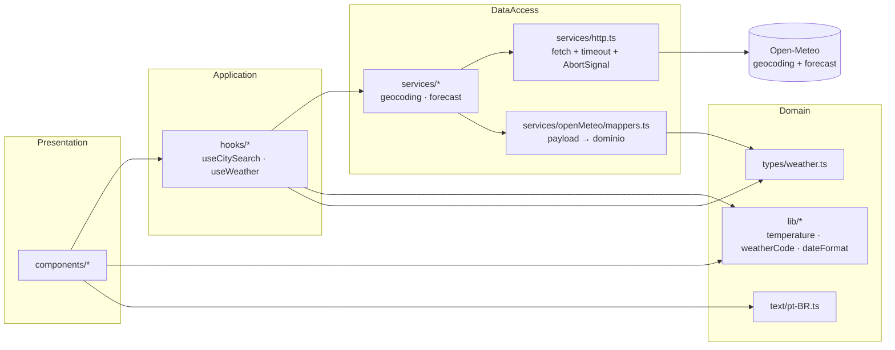
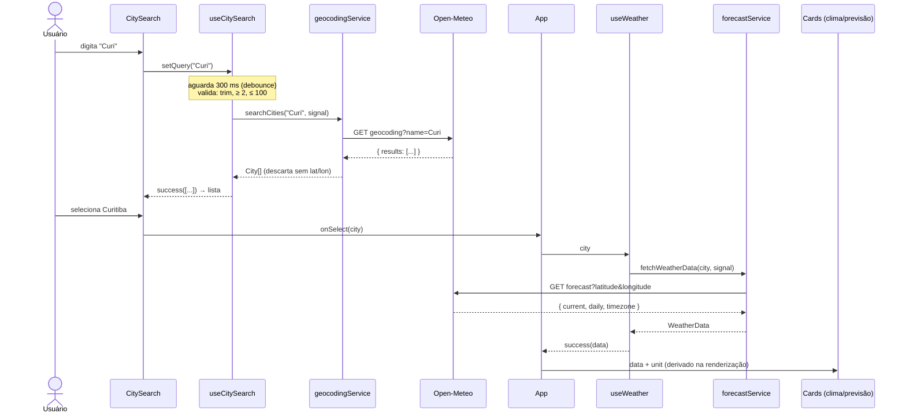
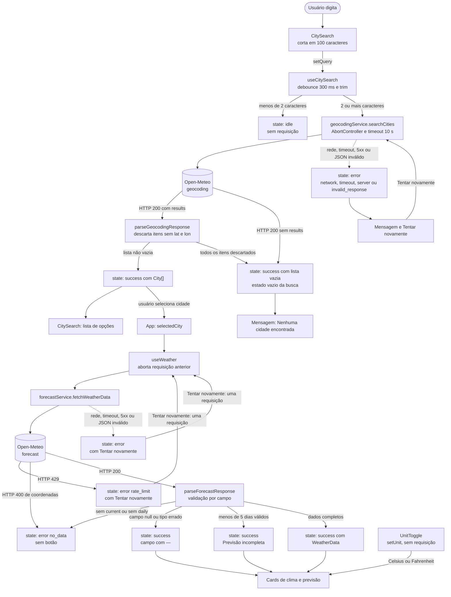

# Plano Técnico — Aplicação de Previsão do Tempo

- **Status:** Rascunho para revisão técnica (v0.1)
- **Fonte de verdade:** [weather-app-spec.md](../specs/weather-app-spec.md) (v0.5)
- **Data:** 2026-11-11
- **Próximo passo:** quebra em tarefas (`tasks/weather-app-tasks.md`)

> Este documento define **decisões e contratos** (tipos, interfaces, endpoints,
> mensagens). Não contém a implementação final. Cada decisão cita o requisito
> da spec que a justifica (`RF-`, `RN-`, `RNF-`, `AC-`, `E-`, `R-`, `OQ-`).

---

## 1. Architecture

### 1.1 Visão geral

SPA 100% no cliente, sem backend próprio (A-04). Os dados vêm direto da
Open-Meteo, sem API key (A-02). O app é um build estático, instalável como PWA
(RNF-08).



### 1.2 Camadas e regras de dependência

| Camada | Pasta | Pode importar | Não pode importar |
| --- | --- | --- | --- |
| Composição | `src/App.tsx`, `src/main.tsx` | components, hooks, `types/` | `services/` diretamente |
| Apresentação | `src/components/` | `lib/`, `text/`, `types/`; hooks **só** nos componentes conectados (`CitySearch` → `useCitySearch`) | `services/`, `fetch`, `setTimeout` |
| Orquestração | `src/hooks/` | services, `lib/`, `types/` | components, `text/` |
| Acesso a dados | `src/services/` | `types/` | React, `lib/`, `text/`, components, hooks |
| Funções puras | `src/lib/` | `types/` | React, services, hooks, components, `text/` |
| Contratos e textos | `src/types/`, `src/text/` | `types/` (text) | qualquer camada acima |

Regra central: **o fluxo de dependência só desce** (composição → apresentação
e orquestração → dados e lib → tipos). Nada abaixo importa algo acima.

**Por quê:**

- **Services não conhecem a UI.** `services/` converte o payload da API em tipos
  de domínio (`types/`). Ele não importa `lib/` porque o texto e o ícone da
  condição são apresentação (seção 4.2). Assim o mapper continua puro e o
  payload não depende de idioma.
- **Hooks concentram estado e efeitos.** `fetch`, timers e `AbortController` ficam
  em hooks ou services, nunca nos componentes (instruções de React). Um hook
  devolve `AsyncState<T>`, e a UI só decide o que mostrar.
- **Componentes são funções de props.** Os de apresentação (`CurrentWeather`,
  `ForecastList`, `ForecastDayCard`, `CityResults`, `StatusMessage`) recebem dados
  e callbacks e renderizam. Só os componentes conectados (`CitySearch`, via
  `useCitySearch`) e `App` (via `useWeather`) chamam hooks. Assim a maior parte
  da UI funciona com dados reais, fixtures ou mocks.
- **`lib/` não tem efeitos.** Conversão, arredondamento e formatação são
  funções puras. Podem ser usadas por hooks e componentes sem risco.
- **Regra verificável.** A tabela é verificada em revisão (agente Review). Se o
  time quiser automatizar, a restrição de imports pode ser feita com regra de
  lint; isso não é adicionado agora para não criar tooling sem necessidade.

### 1.3 Princípios

- **Sem efeitos colaterais escondidos:** `fetch`, timers e `AbortController`
  vivem em hooks ou services (convenção de React).
- **Funções puras:** conversão de unidade, arredondamento, mapeamento de código
  e formatação de data são funções puras em `src/lib/`.
- **Derivar, não duplicar:** a unidade é aplicada na renderização a partir dos
  valores brutos em Celsius (RN-02). Não há cópia convertida no estado.

### 1.4 Como a separação facilita os testes

Cada camada é testada no nível mais barato que ainda prova o comportamento.

| Camada | Tipo de teste | Como isola | O que prova (exemplos) |
| --- | --- | --- | --- |
| `lib/` | Unitário puro (Vitest, sem DOM) | Não precisa de mock: entrada e saída | Conversão C/F e arredondamento RN-05 (AC-05.x); tabela WMO completa (AC-10.3); formato `dd/mm/aaaa` e `HH:mm` (RN-08) |
| `services/` (mappers) | Unitário puro com fixtures | Recebe `unknown` vindo de `tests/fixtures/` | Campo com tipo errado vira `null` (E-27); dia sem máxima e mínima é omitido (AC-04.4); mais de 5 dias são cortados (AC-04.1); payload sem `current` e `daily` vira `no_data` (AC-07.4) |
| `services/http.ts` | Unitário com `fetch` stubado | `vi.stubGlobal('fetch', …)` e fake timers | Timeout de 10 s (AC-07.5); abort externo não é erro (E-12); HTTP 429, 5xx e corpo inválido mapeiam para o `WeatherErrorKind` certo |
| `hooks/` | Unitário com `renderHook` | `vi.mock('src/services/…')` | Debounce de 300 ms (AC-01.1); termo com menos de 2 caracteres não chama a rede (AC-01.2); nova busca aborta a anterior (E-12); transições `idle → loading → success/error` |
| `components/` | Unitário com Testing Library | Recebe props prontas (fixtures de `AsyncState`) | Estados de loading, erro e vazio (AC-07.x); `aria-pressed` do `UnitToggle` (RF-05); texto `—` em campo ausente (E-21) |
| Fluxo completo | E2E (Playwright + axe) | `page.route` com fixtures | Buscar → ver clima → trocar unidade → ver previsão (RF-01 a RF-05); acessibilidade WCAG 2.1 AA sem violações (RNF-03) |

**Resultado prático:** a maior parte das regras de negócio (conversão, mapeamento
e limites de dias) fica em funções puras, testadas sem rede e sem DOM. Assim a
cobertura de regras não depende do E2E, que é lento e mais frágil. O E2E cobre
só a integração entre as camadas.

---

## 2. Tech Stack

| Necessidade | Escolha | Justificativa | Rastreia |
| --- | --- | --- | --- |
| Linguagem | TypeScript em modo `strict` | Contratos explícitos para payloads e tipos de domínio | RNF-09, RNF-10 |
| UI | React (função + hooks) | Já definido nas instruções do projeto | Stack |
| Build / dev server | Vite | Build estático simples, sem SSR | A-01, A-04, R-13 |
| Estilo | Tailwind CSS v3 com `tailwind.config.js` | Tema `night-*`/`accent-*`/`sun` já definido nas instruções | RNF-03, R-05 |
| PWA | `vite-plugin-pwa` (Workbox) | Gera manifest e service worker a partir da config, sem código manual | RNF-08 |
| Testes unitários | Vitest + Testing Library (+ jsdom) | Padrão do projeto; mesma API de `jest` | RNF-06 |
| Testes E2E | Playwright (+ `@axe-core/playwright`) | Padrão do projeto; intercepta rede com `page.route`; axe para a11y | RNF-03, RNF-06 |
| Lint e formatação | Biome | Padrão do projeto; um único tool para lint e formatação | O-4 |
| Pacotes | pnpm | Padrão do projeto | Stack |

**Dependências extras explicitamente evitadas:**

- **Zod (ou similar) para validação:** a validação precisa ser **por campo**
  (E-27: campo com tipo errado vira `—`, sem derrubar a tela). Um schema que
  rejeita o payload inteiro não atende a isso. Validação manual em mappers
  puros é menor e mais direta.
- **TanStack Query / Redux / Zustand:** há apenas dois fluxos assíncronos e
  nenhum cache (RN-06). Um hook com `AbortController` resolve.
- **React Router:** são telas únicas, sem navegação por URL.
- **Biblioteca de ícones:** os ícones são SVG inline pequenos, um por grupo
  de condição (seção 4.4). Evita dependência e facilita o nome acessível.

---

## 3. Project Structure

```text
.
├── public/
│   └── icons/                    # ícones do manifest (192, 512, maskable)
├── src/
│   ├── main.tsx                  # bootstrap React + registro do service worker (via plugin)
│   ├── App.tsx                   # composição das telas e estado de cidade/unidade
│   ├── index.css                 # diretivas do Tailwind e fonte Inter
│   ├── components/               # um componente por arquivo, export default
│   │   ├── CitySearch.tsx        # campo de busca + lista de resultados (RF-01, RF-02)
│   │   ├── CityResults.tsx       # lista selecionável de cidades (RF-02)
│   │   ├── CurrentWeather.tsx       # temperatura, sensação, condição, métricas, horário (RF-03)
│   │   ├── ForecastList.tsx      # grid dos 5 dias + aviso de incompleto (RF-04)
│   │   ├── ForecastDayCard.tsx   # máx./mín./condição de um dia (RF-04)
│   │   ├── UnitToggle.tsx        # botão C/F com aria-pressed (RF-05)
│   │   ├── WeatherIcon.tsx       # ícone SVG por grupo, com nome acessível (RF-10)
│   │   ├── StatusMessage.tsx     # loading, erro, vazio, com role/aria corretos (RF-07)
│   │   └── AttributionFooter.tsx # "Dados: Open-Meteo" (RF-09)
│   ├── hooks/
│   │   ├── useCitySearch.ts      # busca com validação, debounce de 300 ms e cancelamento
│   │   └── useWeather.ts         # clima + previsão da cidade selecionada, com retry() manual
│   ├── services/
│   │   ├── http.ts               # fetchJson com timeout de 10 s e mapeamento de erros
│   │   ├── geocodingService.ts   # searchCities(term, signal)
│   │   ├── forecastService.ts    # fetchWeatherData(city, signal)
│   │   └── openMeteoMappers.ts   # parse de payloads brutos → tipos de domínio (puro)
│   ├── lib/                      # funções puras e testáveis
│   │   ├── temperature.ts        # conversão, arredondamento RN-05, formatação
│   │   ├── weatherCode.ts        # tabela WMO → { label, group } (RF-10)
│   │   └── dateFormat.ts         # HH:mm e dd/mm/aaaa, sem depender do fuso do navegador
│   ├── text/
│   │   └── pt-BR.ts              # todos os textos da UI (RN-04, RNF-07)
│   └── types/
│       └── weather.ts            # City, CurrentWeather, ForecastDay, WeatherData, erros
├── tests/
│   ├── unit/                     # *.test.ts(x), Vitest (espelha src/)
│   ├── e2e/                      # *.spec.ts, Playwright
│   └── fixtures/                 # payloads JSON de geocoding e forecast (versionados)
├── specs/ · plans/ · tasks/      # documentação SDD
├── tailwind.config.js            # paleta night/accent/sun e fonte Inter
├── vite.config.ts                # React, PWA (manifest + Workbox com precache da shell)
├── vitest.config.ts              # jsdom, setup de Testing Library
├── playwright.config.ts          # projetos chromium, firefox, webkit (+ msedge opcional)
└── biome.json
```

**Notas:**

- `lib/` é uma pasta nova em relação às convenções atuais. Ela existe para
  funções puras que não são componentes, hooks, services nem tipos. Se a
  equipe preferir, o conteúdo pode ir para `src/types/` ou um `src/domain/`.
  A decisão não muda nenhum contrato.
- `openMeteoMappers.ts` fica em `services/` porque conhece o formato da API.
  Os tipos de domínio ficam em `types/` e não conhecem o payload.

---

## 4. Data Model

Todos os contratos abaixo ficam em `src/types/weather.ts`, salvo indicação.

### 4.1 Cidade

```ts
export interface City {
  id: number;               // id único do geocoding; usado como key em listas
  name: string;             // nome da localidade, ex.: "Curitiba"
  latitude: number;         // latitude decimal (WGS84); usada no forecast
  longitude: number;        // longitude decimal (WGS84); usada no forecast
  country: string;          // nome do país localizado (language=pt), ex.: "Brasil"
  countryCode: string;      // ISO 3166-1 alpha-2, ex.: "BR"; distingue homônimos (E-04)
  admin1: string | null;    // primeiro nível administrativo, ex.: "Paraná" (AC-01.4, AC-02.2)
}
```

- Nome de exibição (AC-02.2): `[name, admin1, country]` filtrados por `null`/vazio,
  unidos por `", "`. Ex.: `Curitiba, Paraná, Brasil`. Esta regra é uma função
  pura em `lib/`.
- O `timezone` **não** fica em `City`. Ele vem da resposta do forecast
  (`WeatherData.timezone`, com `timezone=auto`, seção 6.2), que é a única fonte de fuso.

### 4.2 Condição meteorológica (apresentação)

Não faz parte dos dados. Os tipos de clima guardam o código WMO bruto, e o texto
e o ícone são derivados na UI. Assim o modelo fica independente de idioma e de ícone.

```ts
export type ConditionGroup =
  | 'sun'
  | 'partly-cloudy'
  | 'cloud'
  | 'fog'
  | 'rain'
  | 'snow'
  | 'thunderstorm'
  | 'unknown';

export interface WeatherCondition {
  labelKey: WeatherLabelKey; // chave em text/pt-BR.ts (D-01); o texto pt-BR fica fora do lib
  group: ConditionGroup;    // escolhe o ícone (WeatherIcon)
}
```

Derivada de `weather_code` por `describeWeatherCode(code: number | null): WeatherCondition`
(seção 4.4). Código `null` ou fora da tabela → `{ labelKey: 'unknown', group: 'unknown' }`
(AC-03.5, AC-10.2).

### 4.3 Clima atual, previsão e dados consolidados

```ts
export interface CurrentWeather {
  time: string;                       // "2026-11-11T15:00" (hora local da cidade, sem offset)
  temperature: number | null;         // temperature_2m, em °C; null se ausente ou inválido
  apparentTemperature: number | null; // apparent_temperature, em °C (sensação térmica)
  weatherCode: number | null;         // weather_code (WMO); mapeado por describeWeatherCode
  isDay: boolean;                     // is_day; escolhe ícone de sol ou lua
  humidity: number | null;            // relative_humidity_2m, em % (RN-03)
  windSpeed: number | null;           // wind_speed_10m, em km/h (wind_speed_unit=kmh)
  precipitation: number | null;       // precipitation, em mm
  pressure: number | null;            // pressure_msl, em hPa
}

export interface ForecastDay {
  date: string;                       // "2026-11-11" (dia local da cidade)
  temperatureMax: number | null;      // temperature_2m_max, em °C
  temperatureMin: number | null;      // temperature_2m_min, em °C
  weatherCode: number | null;         // weather_code diário (WMO)
}

export interface WeatherData {
  city: City;                         // cidade à qual os dados se referem
  timezone: string;                   // fuso IANA da API, ex.: "America/Sao_Paulo"; define o dia 1
  current: CurrentWeather;            // sempre presente; campos ausentes viram null (E-21)
  daily: ForecastDay[];               // 0 a 5 itens, em ordem crescente de date
}
```

Regras que os tipos carregam:

- Todos os valores de temperatura são **Celsius** (RN-02). A unidade de
  exibição não entra no modelo.
- `daily` tem no máximo 5 itens (RF-04). Um dia cujos `temperatureMax` **e**
  `temperatureMin` são `null` é **omitido** (AC-04.4, E-26). Um dia com só um
  dos dois é mantido com `—` no campo ausente.
- Quando `current` e `daily` estão **ambos** ausentes no payload, o mapper
  lança `WeatherError('no_data')` e `WeatherData` não é montado (AC-07.4).

### 4.4 Tabela de condições (`lib/weatherCode.ts`)

Contrato da tabela, copiado da spec (AC-10.3) e transformado em dados:

| weather_code | label | group |
| --- | --- | --- |
| 0 | Céu limpo | sun |
| 1 | Predominantemente limpo | sun |
| 2 | Parcialmente nublado | partly-cloudy |
| 3 | Nublado | cloud |
| 45, 48 | Nevoeiro | fog |
| 51, 53, 55 | Garoa leve, moderada ou intensa | rain |
| 56, 57 | Garoa congelante | rain |
| 61, 63, 65 | Chuva leve, moderada ou forte | rain |
| 66, 67 | Chuva congelante | rain |
| 71, 73, 75 | Neve leve, moderada ou forte | snow |
| 77 | Grãos de neve | snow |
| 80, 81, 82 | Pancadas de chuva leves, moderadas ou violentas | rain |
| 85, 86 | Pancadas de neve | snow |
| 95 | Trovoada | thunderstorm |
| 96, 99 | Trovoada com granizo | thunderstorm |

Contrato de função: `describeWeatherCode(code: number | null): WeatherCondition`.
A tabela é um `Record<number, WeatherCondition>` congelado; o lookup é `O(1)`.

### 4.5 Estado assíncrono e erros

```ts
export type WeatherErrorKind =
  | 'network'           // falha de rede / DNS / offline (E-08)
  | 'timeout'           // 10 s sem resposta (AC-01.8, AC-07.5)
  | 'server'            // HTTP 5xx (E-10)
  | 'rate_limit'        // HTTP 429 (AC-07.7, E-09)
  | 'invalid_response'  // JSON malformado ou não-objeto (E-10)
  | 'no_data';          // HTTP 400 de coordenadas ou payload sem current/daily (AC-07.4, AC-07.6)

export class WeatherError extends Error {
  readonly kind: WeatherErrorKind;
  constructor(kind: WeatherErrorKind) {
    super(kind);
    this.kind = kind;
    this.name = 'WeatherError';
  }
}

export type AsyncState<T> =
  | { status: 'idle' }
  | { status: 'loading' }
  | { status: 'success'; data: T }
  | { status: 'error'; error: WeatherError };
```

Busca sem resultados **não** é erro: é `success` com `data: []`, que a UI trata
como estado vazio (AC-07.3). Por isso `no_data` não se aplica à busca.

### 4.6 Unidade

```ts
export type Unit = 'celsius' | 'fahrenheit';
```

Não é persistida (RF-06, A-09). Vive em `useState` no `App`, com valor inicial
`'celsius'` a cada carregamento (AC-06.1, E-17).

---

## 5. Data Flow

### 5.1 Busca → seleção → clima (fluxo principal)



### 5.2 Passo a passo

1. **Entrada:** `CitySearch` guarda o texto cru. Ao passar de 100 caracteres,
   corta para 100 e mostra `Máximo de 100 caracteres` (AC-01.7).
2. **Debounce:** `useCitySearch` aguarda 300 ms após a última tecla (AC-01.1),
   com `setTimeout` interno. Não há hook separado: o debounce tem um único consumidor.
3. **Validação:** `term = debounced.trim()`. Se `term.length < 2`, o estado
   volta a `idle` e **não há requisição** (AC-01.2, E-01, E-02).
4. **Busca:** `searchCities(term, signal)`. Antes de cada nova busca, o
   `AbortController` anterior é abortado (E-12, E-29).
5. **Mapeamento:** `parseGeocodingResponse` transforma `results` em `City[]`,
   descarta itens sem `latitude`/`longitude` válidos (AC-01.5, E-28) e mantém
   a ordem da API (OQ-07 ainda aberta).
6. **Seleção:** `App` guarda `selectedCity`. Trocar de cidade aborta a
   requisição anterior de clima (E-13, AC-02.3).
7. **Clima:** `useWeather(selectedCity)` chama `fetchWeatherData`, que faz
   **uma única** requisição de forecast com `current` e `daily` (RNF-02).
8. **Mapeamento:** `parseForecastResponse` monta `WeatherData`, limita a
   5 dias, omite dias sem máxima e mínima e valida tipos por campo (E-27).
9. **Renderização:** `CurrentWeather` e `ForecastList` recebem o `WeatherData`
   e a unidade. Cada valor é convertido **na renderização** com
   `formatTemperature(celsius, unit)` (RN-02, E-16).

### 5.3 Fluxo de unidade (RF-05)

Trocar a unidade **não** dispara requisição. É só um `setState` no `App`, e
todos os valores são recalculados a partir de `*C` no próximo render. Isso
garante que `21,4 °C → °F → °C` volta a `21 °C` (AC-05.4).

### 5.4 Caminhos de erro e vazio

Este fluxograma completa o diagrama de sequência da seção 5.1. Cada saída
termina em um estado de `AsyncState` (seção 4.5) ou em um estado de UI (seção 7.3).



Pontos do diagrama:

- **Vazio e erro não se misturam.** Busca sem resultados é `success` com lista
  vazia (AC-07.3). Clima sem dados é `error` `no_data` (AC-07.6).
- **Sem retry automático.** Cada `Tentar novamente` gera uma única requisição
  (AC-07.2).
- **Abort externo não muda estado.** Quando o usuário troca a cidade, o
  `AbortError` da requisição antiga é ignorado (seção 8.3).
- **Unidade não passa por rede.** O `UnitToggle` alimenta a renderização
  diretamente (seção 5.3).

---

## 6. External APIs

Duas chamadas, ambas `GET`, HTTPS, sem chave (RNF-09, A-02). Base e parâmetros
ficam como constantes em `services/`, e os valores de busca são codificados com
`encodeURIComponent` para bater com AC-01.3 (`S%C3%A3o%20Paulo`).
`URLSearchParams` **não** serve aqui, porque codifica espaço como `+`.

### 6.1 Geocoding — busca de cidades

**Endpoint:** `https://geocoding-api.open-meteo.com/v1/search`

**Escopo geográfico (RN-07):** busca global. A requisição não envia parâmetro de
país nem filtra resultados por região.

| Parâmetro | Valor | Motivo |
| --- | --- | --- |
| `name` | termo validado, `encodeURIComponent` | RF-01, AC-01.3, AC-01.6 |
| `count` | `10` | Limite de resultados por busca (escolha de plano; a spec não fixa) |
| `language` | `pt` | Nomes de região e país em pt-BR (RN-04) — **verificar suporte** (ver 6.4) |
| `format` | `json` | Formato padrão |

**Exemplo de URL:**
`https://geocoding-api.open-meteo.com/v1/search?name=Curitiba&count=10&language=pt&format=json`

**Exemplo de resposta (resumido, valores reais de Curitiba/PR):**

```json
{
  "results": [
    {
      "id": 3464975,
      "name": "Curitiba",
      "latitude": -25.42778,
      "longitude": -49.27306,
      "elevation": 924.0,
      "feature_code": "PPLA",
      "country_code": "BR",
      "admin1_id": 3455077,
      "timezone": "America/Sao_Paulo",
      "population": 1948626,
      "country_id": 3469034,
      "country": "Brasil",
      "admin1": "Paraná",
      "admin2": "Curitiba"
    }
  ],
  "generationtime_ms": 0.097
}
```

**Mapeamento para `City`:**

| Campo da API | Campo do modelo | Regra |
| --- | --- | --- |
| `id` | `id` | direto |
| `name` | `name` | direto; descartado se ausente |
| `latitude`, `longitude` | `latitude`, `longitude` | direto; descartado se não forem números finitos |
| `country` | `country` | direto; vazio é tolerado |
| `country_code` | `countryCode` | renomeado (snake_case → camelCase) |
| `admin1` | `admin1` | direto; ausente → `null` |

Ignorados: `elevation`, `feature_code`, `population`, `timezone` e os `*_id`.
O `timezone` do geocoding não entra no modelo (ver 4.1).

**Resposta sem `results`:** a API **omite** a chave quando não há resultado
(validado com `name=zzqxwv`: corpo `{"generationtime_ms": ...}`, HTTP 200). O
mapper trata como lista vazia (AC-07.3). Termo de 1 caractere também retorna
HTTP 200 sem `results`, o que reforça o limite de 2 caracteres (AC-01.2).

**Mapeamento de ausência e tipos:**

```ts
// Contrato, não implementação. Regras de validação:
// - results ausente ou não-array  → []
// - item sem latitude/longitude numéricos e finitos → descartado (AC-01.5, E-28)
// - name ausente ou não-string   → descartado
// - admin1/country ausentes      → null (country vazio é tolerado, exibido sem país)
export function parseGeocodingResponse(raw: unknown): City[];
```

### 6.2 Forecast — clima atual e previsão

**Endpoint:** `https://api.open-meteo.com/v1/forecast`

| Parâmetro | Valor | Motivo |
| --- | --- | --- |
| `latitude`, `longitude` | da `City` selecionada | AC-02.1 |
| `current` | `temperature_2m,apparent_temperature,relative_humidity_2m,wind_speed_10m,precipitation,pressure_msl,weather_code,is_day` | RF-03 e RN-03 (temperatura, sensação, condição, umidade, vento, precipitação e pressão). `is_day` alimenta `CurrentWeather.isDay` |
| `daily` | `weather_code,temperature_2m_max,temperature_2m_min` | RF-04 |
| `forecast_days` | `5` | RF-04 (dia 1 = hoje, RN-01) |
| `temperature_unit` | `celsius` | RN-02: a API sempre entrega °C; explícito para não depender do padrão |
| `wind_speed_unit` | `kmh` | RN-03: vento em km/h; explícito para não depender do padrão |
| `timezone` | `auto` | Datas e horário no fuso da cidade (proposta para OQ-08, ver 6.4) |

**URL completa usada na validação:**
`https://api.open-meteo.com/v1/forecast?latitude=-25.4284&longitude=-49.2733&current=temperature_2m,apparent_temperature,relative_humidity_2m,wind_speed_10m,precipitation,pressure_msl,weather_code,is_day&daily=weather_code,temperature_2m_max,temperature_2m_min&forecast_days=5&temperature_unit=celsius&wind_speed_unit=kmh&timezone=auto`

**Exemplo de resposta (resumido; `current_units` e `daily_units` omitidos):**

```json
{
  "latitude": -25.413006,
  "longitude": -49.241608,
  "utc_offset_seconds": -10800,
  "timezone": "America/Sao_Paulo",
  "timezone_abbreviation": "GMT-3",
  "elevation": 920.0,
  "current": {
    "time": "2026-11-11T12:15",
    "interval": 900,
    "temperature_2m": 23.5,
    "apparent_temperature": 25.3,
    "relative_humidity_2m": 68,
    "wind_speed_10m": 11.2,
    "precipitation": 0.0,
    "pressure_msl": 1014.3,
    "weather_code": 2,
    "is_day": 1
  },
  "daily": {
    "time": ["2026-11-11", "2026-11-12", "2026-11-13", "2026-11-14", "2026-11-15"],
    "weather_code": [51, 95, 55, 45, 96],
    "temperature_2m_max": [24.7, 25.5, 25.7, 27.2, 29.3],
    "temperature_2m_min": [13.6, 14.8, 15.3, 15.4, 16.7]
  }
}
```

**Mapeamento para `WeatherData`:**

| Campo da API | Campo do modelo | Regra |
| --- | --- | --- |
| — (entrada) | `city` | vem da `City` selecionada; **não** da resposta |
| `timezone` | `timezone` | direto; ausente → erro de payload (ver regras abaixo) |
| `current.time` | `current.time` | direto (hora local, sem offset) |
| `current.temperature_2m` | `current.temperature` | número finito ou `null` |
| `current.apparent_temperature` | `current.apparentTemperature` | número finito ou `null` |
| `current.weather_code` | `current.weatherCode` | inteiro ou `null` |
| `current.is_day` | `current.isDay` | `1` → `true`; `0` → `false`; ausente → `true` |
| `current.relative_humidity_2m` | `current.humidity` | número finito ou `null` |
| `current.wind_speed_10m` | `current.windSpeed` | número finito ou `null` |
| `current.precipitation` | `current.precipitation` | número finito ou `null` |
| `current.pressure_msl` | `current.pressure` | número finito ou `null` |
| `daily.time[i]` | `daily[i].date` | string `YYYY-MM-DD` |
| `daily.temperature_2m_max[i]` | `daily[i].temperatureMax` | número finito ou `null` |
| `daily.temperature_2m_min[i]` | `daily[i].temperatureMin` | número finito ou `null` |
| `daily.weather_code[i]` | `daily[i].weatherCode` | inteiro ou `null` |

Pontos de atenção:

- A `latitude`/`longitude` da resposta **não** são usadas. A API ajusta as
  coordenadas à grade do modelo (no exemplo, `-25.4284` virou `-25.413006`).
  O `city` do modelo mantém as coordenadas da busca.
- `current.interval` (900 s) e as `*_units` não são usados. A unidade já é
  fixada com `temperature_unit=celsius`.
- O `daily` é montado por índice: `daily[i]` usa o `i`-ésimo valor de cada
  array. Os arrays são alinhados pelo menor tamanho (ver regras).

**Regras de mapeamento (`parseForecastResponse(raw, city)`):**

- `raw` não-objeto → `invalid_response` (E-10).
- `current` **e** `daily` ausentes → `no_data` (AC-07.4).
- `daily` presente, mas sem nenhum dia válido (lista vazia ou todos sem máxima
  e mínima) → `no_data` (AC-07.4). Com 1 a 4 dias válidos, segue como `success`
  incompleto (AC-04.3, E-07).
- Só um dos dois ausente → o que faltar vira `null` (E-21).
- Número inválido ou de tipo errado → `null` (E-27, RNF-09).
- Arrays de `daily` com tamanhos diferentes → usa o menor tamanho e descarta
  o restante (E-26).
- Dias ordenados pela `date` crescente e cortados em 5 (AC-04.1). Se a API
  devolver 7 dias, só os 5 primeiros são usados.
- Dia com `temperatureMax` e `temperatureMin` `null` → omitido (AC-04.4).

### 6.3 Tratamento de HTTP

Implementado em `services/http.ts`, uma única função `fetchJson(url, signal)`:

| Situação | Erro lançado | Rastreia |
| --- | --- | --- |
| Falha de `fetch` (rede, DNS, offline) | `network` | E-08 |
| Timeout de 10 s (`AbortController` disparado pelo timer) | `timeout` | AC-01.8, AC-07.5 |
| Abort externo (troca de cidade / nova busca) | não é erro: a promise é descartada | E-12, E-13 |
| HTTP 429 | `rate_limit` | AC-07.7 |
| HTTP 400 no forecast | `no_data` (tratado pelo serviço de forecast) | AC-07.6 |
| HTTP 5xx | `server` | AC-07.2, E-10 |
| Corpo não é JSON | `invalid_response` | E-10 |

O timeout e o abort externo usam o **mesmo** `AbortController` com motivo
diferente (timer vs. cancelamento do chamador). Assim o código consegue
diferenciar os dois casos sem depender de `AbortSignal.timeout`, que não está
disponível em todos os navegadores-alvo (RNF-11).

**Nenhuma chamada usa cache** (RN-06). Cada seleção ou busca gera uma nova
requisição.

### 6.4 Pontos a validar antes de fechar o Plan

Chamadas reais feitas com `curl` (Curitiba, coordenadas da busca) confirmaram os
pontos abaixo. O spike ainda vale como teste automatizado no início de Tasks.

1. **Verificado:** `forecast` retorna `timezone` (`America/Sao_Paulo`) e
   `current.time` no horário local quando `timezone=auto` (A-12).
2. **Verificado:** `language=pt` retorna `admin1` ("Paraná") e `country`
   ("Brasil") em português (AC-01.4, AC-02.2).
3. **Verificado:** busca sem resultados **omite** a chave `results`
   (HTTP 200). Coordenadas fora de faixa retornam HTTP 400 com corpo
   `{"reason": "...", "error": true}`, que mapeia para `no_data`.
4. **Novo:** `current.is_day` vem como `1`/`0` (inteiro), não booleano. O
   mapeamento acima converte.
5. **Pendente:** limites de uso publicados pela Open-Meteo para o plano sem chave (R-01, OQ-03).
   Esses números mudam com o tempo e devem ser confirmados na documentação
   oficial, não fixados aqui.

---

## 7. State Management

### 7.1 Onde cada estado vive

| Estado | Dono | Mecanismo | Rastreia |
| --- | --- | --- | --- |
| Texto digitado | `CitySearch` | `useState` | RF-01 |
| Termo com debounce | `useCitySearch` | `setTimeout` interno | AC-01.1 |
| Resultados da busca + status | `useCitySearch` | `useState<AsyncState<City[]>>` | RF-01, RF-07 |
| Aviso de limite de 100 caracteres | `useCitySearch` | `useState<boolean>` | AC-01.7 |
| Cidade selecionada | `App` | `useState<City \| null>` | RF-02 |
| Clima + previsão + status | `useWeather` | `useState<AsyncState<WeatherData>>` + contador de retry | RF-03, RF-04, RF-07 |
| Unidade (C/F) | `App` | `useState<Unit>('celsius')` | RF-05, RF-06 |

### 7.2 Regras

- **Sem store global.** Há um único `selectedCity` e uma única unidade. Elevar
  o estado ao `App` é suficiente.
- **Derivado, não copiado.** Valores convertidos não são guardados. Todo
  render calcula `formatTemperature(*C, unit)` (react instructions: derivar
  estado sempre que possível).
- **Cancelamento por efeito.** `useCitySearch` e `useWeather` criam um
  `AbortController` por requisição e o abortam no cleanup do `useEffect`. Isso
  cobre troca rápida de cidade (E-13), buscas em sequência (E-12), Enter
  repetido (E-29) e o duplo efeito do `StrictMode` em desenvolvimento.
- **Retry explícito.** `useWeather` expõe `retry()`, que incrementa um contador
  usado como dependência do efeito. O clique no botão faz **exatamente uma**
  requisição com os mesmos parâmetros (AC-07.2).
- **Nada persistido.** Nenhum `localStorage`, `sessionStorage`, `IndexedDB` ou
  cookie (RF-06, A-09, RNF-05). Recarregar volta ao estado inicial (E-17).
- **Estado inicial** sem cidade: `selectedCity = null` e a UI mostra a
  instrução `Pesquise uma cidade para ver o clima.` (AC-07.8, OQ-16).

### 7.3 Estados explícitos da UI

O tipo `AsyncState<T>` (seção 4.5) tem quatro variantes. O estado `empty` da
UI não é uma quinta variante: é `success` com lista vazia. Assim, o tipo não
ganha um caso que o domínio nunca produz para clima.

| Estado UI | Representação em `AsyncState` | Quando ocorre | Tela |
| --- | --- | --- | --- |
| `idle` | `{ status: 'idle' }` | Termo com menos de 2 caracteres, ou nenhuma cidade selecionada | Nada, ou a instrução `Pesquise uma cidade para ver o clima.` (AC-07.8) |
| `loading` | `{ status: 'loading' }` | Requisição em curso | `Carregando...` com `aria-busy="true"` (AC-07.1) |
| `success` | `{ status: 'success', data }` com dados | Resposta válida, mesmo parcial | Resultados ou clima, com `—` nos campos ausentes |
| `empty` | `{ status: 'success', data: [] }` | Busca sem resultados (AC-07.3) | `Nenhuma cidade encontrada para "{termo}".` |
| `error` | `{ status: 'error', error }` | Qualquer `WeatherErrorKind` | Mensagem por tipo, com ou sem botão (seção 8.2) |

Quem decide `empty` é o componente que recebe o `success`, checando
`data.length === 0`. Os hooks não criam esse caso de exibição.

### 7.4 Contratos dos hooks

```ts
// hooks/useCitySearch.ts
export interface CitySearchResult {
  query: string;                       // valor cru digitado
  setQuery: (value: string) => void;   // corta em 100 e liga o aviso se passou
  limitReached: boolean;               // AC-01.7
  state: AsyncState<City[]>;           // idle quando term < 2 caracteres
}
export function useCitySearch(): CitySearchResult;

// hooks/useWeather.ts
export interface WeatherResult {
  state: AsyncState<WeatherData>;  // idle quando city é null
  retry: () => void;                   // AC-07.2
}
export function useWeather(city: City | null): WeatherResult;
```

### 7.5 Conversão de unidade na renderização

Funções puras em `lib/temperature.ts`. Não fazem I/O e não guardam estado.

```ts
// lib/temperature.ts
export function toUnit(celsius: number, unit: Unit): number;
// celsius → fahrenheit: C × 9/5 + 32. Com 'celsius', devolve o valor sem alterar.

export function formatTemperature(celsius: number | null, unit: Unit): string;
// Devolve "21 °C" ou "70 °F". Devolve "—" quando celsius é null (E-21).
// Arredondamento de exibição conforme RN-05, aplicado só no texto final.
```

Regras:

- Trocar a unidade só chama `setUnit`. Não há chamada a `services/`, e o
  controle segue AC-05.3 (`aria-pressed` e `role="status"`).
- Como os dados ficam em Celsius, a ida e volta preserva o valor (AC-05.4).
- Durante um `loading`, a unidade já escolhida vale para o que chegar depois
  (E-16). Nenhum estado extra é necessário.
- Testes de `lib/temperature.ts` são puros: valores de entrada e saída, sem mock.

---

## 8. Error Handling Strategy

### 8.1 Princípios

- **Nunca exibir dado parcial como válido** (E-10). Se o payload é inválido,
  a tela mostra erro, não valores soltos.
- **Campo ruim não derruba a tela** (E-21, E-27). Vira `—` e o resto segue.
- **Erros tratados por tipo**, não por mensagem genérica única (RNF-04). O
  `WeatherErrorKind` decide a mensagem e se existe botão.
- **Erros anunciados uma vez** via `role="status"` (loading, sucesso e
  informativos) ou `role="alert"` (erros), conforme E-19.

### 8.2 Matriz de estados

| Situação | Origem | Estado | Mensagem exibida | Botão `Tentar novamente` | Rastreia |
| --- | --- | --- | --- | --- | --- |
| Termo com menos de 2 caracteres ou só espaços | busca | `idle` | nenhuma | não | AC-01.2, E-01, E-02 |
| Termo acima de 100 caracteres | busca | `idle`/`success` + aviso | `Máximo de 100 caracteres` | não | AC-01.7 |
| Busca carregando | busca | `loading` | `Carregando...` | não | AC-07.1 |
| Busca sem resultados | busca | `success([])` | `Nenhuma cidade encontrada para "{termo}". Verifique o nome digitado.` | não | AC-07.3, E-03 |
| Busca: timeout, rede, 5xx, JSON inválido | busca | `error` | `Não foi possível carregar o clima. Tente novamente.` | sim | AC-01.8, E-24, RNF-04 |
| Clima: timeout, rede, 5xx, JSON inválido | clima | `error` | `Não foi possível carregar o clima. Tente novamente.` | sim | AC-07.2, AC-07.5 |
| Clima: HTTP 429 | clima | `error` (`rate_limit`) | `Muitas consultas em pouco tempo. Tente novamente em instantes.` | sim | AC-07.7, E-09 |
| Clima: HTTP 400 de coordenadas, sem `current` e `daily`, ou `daily` sem dia válido | clima | `error` (`no_data`) | `Sem dados disponíveis para esta cidade.` | não | AC-07.4, AC-07.6, E-06, E-25 |
| Previsão com menos de 5 dias válidos | clima | `success` | `Previsão incompleta: {n} de 5 dias disponíveis` | não | AC-04.3, E-07 |
| Campo `null` ou inválido em `current` | clima | `success` | `—` no campo | não | AC-03.5, E-21 |
| `weather_code` fora da tabela | clima/previsão | `success` | `Condição indisponível` + ícone genérico | não | AC-10.2, E-22 |
| Tela inicial sem cidade | — | `idle` | `Pesquise uma cidade para ver o clima.` | não | AC-07.8 |

**Observações:**

- `no_data` não tem retry porque repetir a mesma coordenada não muda o resultado.
- A mensagem de `rate_limit` é diferente da genérica, porque o usuário precisa
  saber que o problema é de cota, não de rede (AC-07.7).
- A mensagem `Sem dados…` **não** é a de `Nenhuma cidade…` (AC-07.6). Isso
  separa "geocoding não achou" de "achou, mas o clima não existe".

### 8.3 Tratamento na camada de hooks

- Cada hook tem um `try/catch` ao redor da chamada de serviço. Erro que não
  seja `WeatherError` é convertido em `invalid_response` (guarda de último
  recurso, para nunca vazar erro não tratado — E-10, RNF-04).
- Abort externo (`AbortError` disparado pelo cleanup) **não** muda o estado.
  Quem cancelou já foi substituído por uma nova requisição.

### 8.4 O que não fazemos

- **Sem retry automático.** O usuário decide repetir (AC-07.2). Retry
  automático aumenta o risco de estourar a cota (R-01).
- **Sem Error Boundary global** neste escopo. Os parsers não lançam exceção
  fora de `WeatherError`, e os componentes não fazem I/O. Se a equipe quiser
  uma rede extra, pode ser adicionada depois sem mudar contratos.
- **Sem monitoramento de erros** neste escopo. A ferramenta é OQ-17, ainda
  aberta. Quando for escolhida, deve enviar apenas erros técnicos, sem telemetria
  de uso (RNF-05).

---

## 9. Testing Strategy

### 9.1 Pirâmide

| Nível | Ferramenta | Pasta | O que cobre | Rede |
| --- | --- | --- | --- | --- |
| Unitário puro | Vitest | `tests/unit/lib/` | conversão, arredondamento, tabela WMO, formatação | não |
| Unitário de services | Vitest | `tests/unit/services/` | mappers, `http.ts`, timeout, abort, status HTTP | mock de `fetch` |
| Unitário de hooks | Vitest + Testing Library | `tests/unit/hooks/` | debounce, validação, cancelamento, retry | mock de `src/services/` |
| Unitário de componentes | Vitest + Testing Library | `tests/unit/components/` | estados, labels, `aria-*`, unidade | mock de `src/services/` |
| E2E | Playwright | `tests/e2e/` | fluxos de usuário, viewports, a11y, offline | `page.route` com fixtures |
| Opcional (CI separado) | Playwright | `tests/e2e/live/` | API real, só smoke | real (R-10) |

**Regra:** `tests/unit/` nunca chama a API real (instruções de testes). E2E
usa apenas fixtures (R-10).

### 9.2 Mapeamento de critérios para testes

Todo teste tem o ID do critério no título (ex.: `AC-05.2: converte 0, 100, -40 e 37`).
Assim o checklist de RNF-06 ("cada AC mapeado a pelo menos um teste") pode ser
conferido por busca no código.

| Área | Critérios cobertos | Nível principal |
| --- | --- | --- |
| Conversão e arredondamento | AC-05.1, AC-05.2, AC-05.4, RN-05, E-14 | unitário (`lib/temperature`) |
| Tabela WMO | AC-10.1, AC-10.2, AC-10.3, AC-03.5 | unitário (`lib/weatherCode`), parametrizado com todas as linhas |
| Mappers | AC-01.5, AC-03.5, AC-04.1, AC-04.3, AC-04.4, AC-07.4, E-21, E-26, E-27, E-28, RNF-09 | unitário com fixtures, incluindo payloads malformados |
| HTTP e timeouts | AC-01.8, AC-07.2, AC-07.5, AC-07.7, E-08, E-09, E-10, E-11 | unitário com `fetch` mockado |
| Busca | AC-01.1 a AC-01.4, AC-01.6, AC-01.7, E-01, E-02, E-05, E-12, E-23, E-29 | hook + E2E |
| Seleção e troca de cidade | AC-02.1 a AC-02.3, E-13 | hook + E2E |
| Clima e previsão | AC-03.1 a AC-03.4, AC-04.2, AC-06.1, E-15 | componente + E2E |
| Unidade | AC-05.3, AC-05.4, E-16, E-17 | componente + E2E |
| Estados | AC-07.1 a AC-07.8 | hook + componente + E2E |
| Responsividade | AC-08.1 a AC-08.3, E-18 | E2E (viewports 320, 375, 768, 1280) |
| Atribuição | AC-09.1, AC-09.2 | componente + E2E |
| Acessibilidade | AC-03.2, RNF-03, E-19, E-20 | componente + axe no E2E |
| Privacidade | RNF-05, AC-06.2, AC-06.3 | E2E com captura de rede |
| PWA e offline | RNF-08, E-08 | E2E com `context.setOffline(true)` |

### 9.3 Detalhes por nível

**Unitário (Vitest):**

- `lib/temperature.ts`: arredondamento em empate (`2,5 → 3`, `−2,5 → −2`); conversão
  de `21,4 °C` → `71 °F`; ida e volta.
- `lib/weatherCode.ts`: uma asserção por linha da tabela (AC-10.3) e o
  caso `999` / `null` (AC-03.5).
- `openMeteoMappers.ts`: payloads em `tests/fixtures/` (válido, sem `current`,
  sem `daily`, 3 dias, 7 dias, `null` no meio, string no lugar de número,
  `latitude` string).
- `services/http.ts`: `fetch` mockado para 429, 500, rede, JSON inválido, e
  timeout com timers falsos (`vi.useFakeTimers`).
- `geocodingService.ts` e `forecastService.ts`: `fetch` mockado. Verificam a
  URL montada (`encodeURIComponent` em `S%C3%A3o%20Paulo`, AC-01.3; parâmetros
  `current`, `daily`, `timezone`, `forecast_days=5`), o repasse do `signal` e
  que a resposta passa pelo mapper antes de chegar ao hook.
- Hooks: `useCitySearch` com timers falsos (debounce de 300 ms; 1 caractere não
  dispara; trim; limite de 100). `useWeather` com um serviço que não resolve,
  para testar troca de cidade e `retry()`.
- Componentes: `UnitToggle` com `aria-pressed` (AC-05.3);
  `WeatherIcon` com nome acessível igual à descrição (AC-03.2); `StatusMessage`
  com `role` correto (AC-07.1, E-19).

**E2E (Playwright):**

- Projetos: `chromium`, `firefox`, `webkit`. `msedge` como canal do Chromium
  pode ser adicionado sem mudar os testes (RNF-11).
- Viewports: 320×568 (AC-08.1, E-18), 375, 768, 1280. Para AC-08.3 (zoom de
  400%), o equivalente é 320 CSS px de largura útil (a spec já define isso).
- Conteúdo (AC-08.2): em cada viewport, `getBoundingClientRect` confere que
  nenhum par de elementos visíveis se sobrepõe e nenhum elemento passa da largura
  da viewport.
- Métricas (AC-03.3, AC-03.6, AC-03.7): o E2E confirma que os textos `Umidade`,
  `Vento`, `Precipitação` e `Pressão` aparecem com valores, e que `UV` não aparece.
- E2E de virada de dia (E-15): fixture com `current.time` perto de meia-noite no
  fuso da cidade. Confere que a previsão começa no dia 1 sem repetir nem pular dias.
- Ao menos um teste em viewport mobile (instruções de testes).
- Acessibilidade: `@axe-core/playwright` nas telas principais, falhando em
  violações `critical` ou `serious` (RNF-03). Teste de teclado: Tab em ordem
  visual, Enter para selecionar (AC-02.1).
- Privacidade: contexto sem permissão de geolocalização e captura de todas as
  requisições; nenhuma para domínios de analytics (RNF-05).
- Offline: carregar a página, depois `context.setOffline(true)`, buscar e ver a
  mensagem de AC-07.2 (RNF-08).

**Desempenho (RNF-02):**

- Medição com perfil "Slow 4G" do Lighthouse, 30 execuções por fluxo, p75 ≤ 2 s.
- Só Chromium suporta a throttling via CDP. Por isso o teste roda em job
  separado, não no CI de cada PR. Trade-off registrado na seção 10.

### 9.4 Matriz de componentes por estado (Vitest)

Cada componente de apresentação recebe props prontas, então cada célula vira um
teste sem mock de rede. `vazio` só se aplica onde a spec define estado vazio.

| Componente | loading | erro | vazio | sucesso | Critérios |
| --- | --- | --- | --- | --- | --- |
| `CitySearch` | `Carregando...` em `role="status"`, `aria-busy="true"` | mensagem de AC-07.2 em `role="alert"`, botão `Tentar novamente` chama `retry` uma vez | `Nenhuma cidade encontrada para "{termo}".` | lista de opções com `admin1` e `country`; Enter seleciona | AC-01.8, AC-07.1, AC-07.2, AC-07.3, AC-02.1, E-19 |
| `WeatherPanel` (clima) | `aria-busy="true"` e esqueleto | mensagem por `WeatherErrorKind`; `no_data` sem botão | não se aplica (sem dados vira `no_data`) | temperatura, sensação, condição e `Atualizado às HH:mm` | AC-07.2, AC-07.4, AC-07.6, AC-03.1, AC-03.2 |
| `CurrentWeather` | esqueleto, sem valores | não renderizado | não se aplica | `null` em `apparentTemperature` ou em métrica vira `—` | AC-03.5, AC-03.7, E-21 |
| `ForecastList` | esqueleto | não renderizado | não se aplica | 5 cards; com 3 dias, `Previsão incompleta: 3 de 5 dias disponíveis` | AC-04.2, AC-04.3, E-07 |
| `UnitToggle` | continua funcionando (E-16) | não se aplica | não se aplica | `aria-pressed` alterna; `role="status"` com `Unidade alterada para Fahrenheit` | AC-05.3, E-16 |
| `StatusMessage` / tela inicial | — | — | — | `Pesquise uma cidade para ver o clima.` sem cards | AC-07.8, E-19 |

Os estados vêm das fixtures de `AsyncState` da seção 4.5. Os componentes não
importam `services/`, o que mantém os testes puros de rede.

### 9.5 Scripts esperados (`package.json`)

| Script | Comando (intenção) | Checklist |
| --- | --- | --- |
| `lint` | `biome check .` | `pnpm lint` |
| `build` | `tsc -b && vite build` | `pnpm build` |
| `test` | `vitest run` (unitários) | `pnpm test` |
| `test:e2e` | `playwright test` | exigido por O-4 e RNF-06 |
| `test:e2e:live` | `playwright test tests/e2e/live` | opcional, não bloqueia |

---

## 10. Risks & Trade-offs

### 10.1 Riscos com mitigação técnica (complementam a seção 8 da spec)

| Risco (spec) | Decisão técnica deste plano | Pendência |
| --- | --- | --- |
| R-01 Limite de uso da API | uma requisição por seleção; sem retry automático; sem cache; debounce 300 ms; erro 429 com mensagem própria | confirmar limites (6.4), OQ-02; a mitigação original "cache com TTL" conflita com RN-06 (ver 10.2, item 1) |
| R-02 Mudança de contrato | mappers tolerantes por campo, tipos de payload em `openMeteoMappers.ts`, fixtures versionadas | — |
| R-03 Homônimos | `admin1` e `country` sempre exibidos; ordem da API mantida | OQ-07 |
| R-04 Previsão desatualizada | `current.time` exibido como "Atualizado às HH:mm" | política de refresh sem OQ própria (ver 10.2, item 4) |
| R-05 Contraste no glassmorphism | tokens de cor definidos em `tailwind.config.js` antes dos componentes; axe no E2E | validar tokens na primeira tarefa de UI |
| R-06 Arredondamento | conversão apenas na renderização, a partir do bruto; `Math.floor(x + 0.5)` para RN-05; testes de empate | — |
| R-09 `backdrop-filter` | fallback com fundo sólido via classe Tailwind de suporte (E-20) | teste visual nos navegadores-alvo |
| R-10 E2E instável | `page.route` com fixtures; teste contra API real isolado e opcional | — |
| R-11 Fuso e meia-noite | `timezone=auto`; datas formatadas a partir da string local (sem `Date` do navegador) | confirmar 6.4.1 |
| R-13 Hospedagem | build 100% estático; nenhum requisito de servidor | OQ-13 |
| R-14 Monitoramento | sem monitoramento neste escopo | OQ-17 |
| R-07 Escopo cresce | itens fora de escopo ficam listados na seção 9 da spec; nenhuma tela ou dependência para eles neste plano | — |
| R-08 Uso comercial e atribuição | atribuição visível "Dados: Open-Meteo" (AC-09.1, AC-09.2); sem recurso que dependa de plano pago | validar termos (OQ-03); prever plano pago se necessário |
| R-12 LGPD e envio de IP | nenhum dado salvo localmente (RF-06); nenhuma requisição a analytics (RNF-05) | validação jurídica antes do lançamento (OQ-12) |
| R-15 Decisões tardias de unidade e idioma | Q1, Q2 e Q5 decididas; textos centralizados em `text/pt-BR.ts` (RN-04) | — |
| R-16 Geolocalização futura | fora de escopo (Q3); o app não pede permissão de localização | — |

### 10.2 Inconsistências encontradas na spec

1. **R-01 × RN-06.** A mitigação de R-01 diz "cache com TTL", mas RN-06 proíbe
   qualquer cache de dados meteorológicos. Este plano segue **RN-06**. Sugestão:
   revisar a mitigação de R-01 para "sem cache; debounce; tratamento de erros;
   plano B (OQ-02)".
2. **OQ-08 ainda aberta, mas com proposta.** A seção 6.2 propõe o **fuso da
   cidade** (`timezone=auto`), que é o que faz o "dia 1" e o horário fazerem
   sentido para quem consulta uma cidade distante. A decisão precisa ser
   confirmada pelo produto antes de fechar OQ-08.
3. **A-12 pede verificação na fase Plan.** Não foi possível executar a chamada
   real neste ambiente. Está registrada como pendência em 6.4, com spike no
   início das Tasks.
4. **OQ-09 usada para dois assuntos.** R-04 aponta OQ-09 como política de
   refresh, mas o changelog da spec (versão 0.5) usa OQ-09 para o arredondamento
   de RN-05. A política de refresh não tem OQ própria. Sugestão: criar uma OQ
   específica na spec.

### 10.3 Trade-offs assumidos

| Decisão | Alternativa considerada | Por que esta |
| --- | --- | --- |
| Validação manual em mappers | Zod | Validação precisa ser por campo (E-27); evita dependência |
| Estado em hooks e `App` | Zustand / TanStack Query | Dois fluxos, sem cache; menos abstração |
| Sem cache de dados | Cache com TTL (R-01 original) | RN-06 é a regra de produto vigente |
| PWA via `vite-plugin-pwa` | Service worker escrito à mão | Menos código para manter; mesma garantia de precache da shell |
| Uma requisição de forecast (`current` + `daily`) | Duas requisições separadas | Menos latência, alinhado a RNF-02 |
| Conversão na renderização | Guardar valores convertidos no estado | Garante AC-05.4 (ida e volta) e E-16 sem duplicar fonte |
| Desempenho em job separado | Medir em todo PR | Throttling só existe no Chromium e é lento |
| Sem Error Boundary | Boundary global | Parsers não lançam fora de `WeatherError`; menos superfície |
| Sem retry automático | Retry com backoff | Respeita cota (R-01) e deixa a decisão com o usuário (AC-07.2) |
| Tailwind v3 | Tailwind v4 (config em CSS) | Segue a convenção do projeto (`tailwind.config.js`) |
| Vitest | Jest | Integra com Vite sem configuração extra e usa a mesma sintaxe de `expect` |
| `fetch` stubado com `vi.stubGlobal` | MSW (interceptação de rede) | Menos dependência; o contrato a testar é o mapper e o timeout, não o transporte. MSW fica como plano B se houver muitos handlers |
| Testing Library (roles e labels) | Enzyme / snapshots | Testa o que o usuário percebe e reforça a acessibilidade (RNF-03); snapshots são frágeis com Tailwind |
| Playwright (chromium, firefox, webkit) | Cypress | Cobre WebKit para o Safari (RNF-11) e tem `page.route` e `setOffline` nativos |
| `@axe-core/playwright` no E2E | `jest-axe` nos componentes | Axe precisa do DOM renderizado com CSS, incluindo contraste do glassmorphism (R-05) |
| Fixtures em `page.route` no E2E | API real em todo PR | Estabilidade (R-10). A API real fica no job `live`, com smoke apenas |
| Throttling de desempenho em Chromium | Medir nos três navegadores | CDP só existe no Chromium. Os outros navegadores são validados por funcionalidade, não por tempo |

### 10.4 Itens ainda em aberto que bloqueiam a fase de Tasks

Nenhum bloqueia o início das Tasks. Todos têm impacto em tarefas específicas:

- **OQ-08** (fuso): afeta a tarefa de mapeamento de datas.
- **6.4** (validação dos endpoints): spike como primeira tarefa de services.
- **OQ-07** (ordem dos resultados): decisão provisória é "ordem da API".
- **OQ-13** (hospedagem) e **OQ-17** (monitoramento): não afetam o código do app.

---

## 11. Rastreabilidade resumida

| Requisito | Onde é atendido neste plano |
| --- | --- |
| RF-01, RF-02 | 5.2, 6.1, 7.4 (`useCitySearch`), 8.2 |
| RF-03 | 4.3, 6.2, componentes `CurrentWeather`, `WeatherIcon` |
| RF-04 | 4.3, 6.2 (limite de 5 dias, omissão), `ForecastList` |
| RF-05, RF-06 | 4.6, 5.3, 7.2 (sem persistência) |
| RF-07 | 4.5, 7.3, 8.2 |
| RF-08 | 3 (layout), 9.3 (viewports) |
| RF-09 | `AttributionFooter`, E2E de AC-09.1/09.2 |
| RF-10 | 4.4, `lib/weatherCode.ts` |
| RN-02 | 4.3, 5.3, 7.2 |
| RN-04, RNF-07 | `text/pt-BR.ts` (8.2 traz as mensagens) |
| RN-05 | 9.3 (`lib/temperature.ts`) |
| RN-06, RF-06, RNF-05 | 6.3, 7.2 |
| RN-08 | `lib/dateFormat.ts` (HH:mm, dd/mm/aaaa) |
| RNF-01, RNF-03 | 9.3 (E2E de viewport e axe) |
| RNF-02 | 5.2 (uma requisição), 9.3 (job de desempenho) |
| RNF-04 | 8.2 (matriz de erros) |
| RNF-06 | 9.2, 9.5 |
| RNF-08 | 2 (`vite-plugin-pwa`), 9.3 (offline) |
| RNF-09 | 6.2 (validação por campo), 9.3 (testes de payload malformado) |
| RNF-10 | 1.2 (camadas), 3 (estrutura) |
| RNF-11 | 9.3 (projetos de navegador) |
